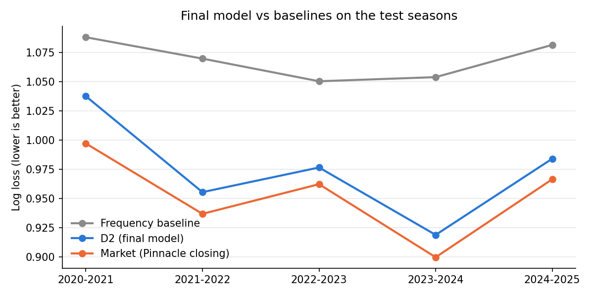
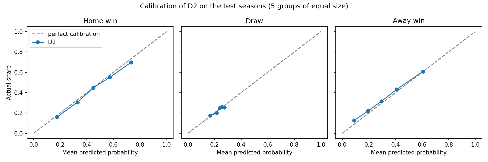

# Forecasting Premier League results vs the betting market

How well can a model built only on public data forecast the result of a Premier League match (home win, draw or away win) before kickoff, compared with bookmaker odds?

## Result

A multinomial logistic regression on four pre-match features clearly beats the base-rate forecast but does not beat the betting market.



| Log loss (lower is better) | Test seasons 2020/21–2024/25 | Holdout 2025/26 |
|---|---|---|
| Frequency baseline (historical outcome shares) | 1.069 | 1.084 |
| **Final model (D2)** | **0.974** | **1.041** |
| Market: closing odds with the margin removed | 0.952 | 1.012 |
| Share of the baseline-to-market gap closed by the model | about 80% | 59% (95% interval 1% to 88%) |

- **Test seasons:** the model beats the frequency baseline by 0.094 (95% interval 0.074 to 0.114) and trails the market by 0.022 (0.014 to 0.031).
- **Holdout, scored once after the model was frozen:** the gap closed is lower, but with one season of 380 matches the interval is wide. The model is weaker after January: it closes 65% of the gap on the first 210 matches and 49% on the last 170.
- **Which market:** the test seasons use Pinnacle closing odds. The holdout uses the average closing odds of all bookmakers, because Pinnacle odds stop in January 2026. Both benchmarks score the same on the test seasons (0.9524 and 0.9525), so the switch is fair.

## Data

[football-data.co.uk](https://www.football-data.co.uk/englandm.php) Premier League season files, 2012/13 to 2025/26: results, shots, shots on target and bookmaker odds. `notes.txt` is the site's column dictionary. The data belongs to football-data.co.uk and is included here only to make the analysis reproducible.

| Seasons | Role |
|---|---|
| 2012/13 | Warm-up: builds ratings and rolling features, never scored |
| 2013/14 – 2019/20 | Training history |
| 2020/21 – 2024/25 | Test seasons, walk-forward: each season is predicted by a model trained on all earlier seasons. Used to choose the model |
| 2025/26 | Final holdout, scored once |

## Method

1. **Data checks:** 380 matches per season, no missing values or duplicates, results consistent with goals, consistent team names. The checks are enforced with `assert` statements.
2. **Baselines:**
   - uniform (1/3 each)
   - historical frequencies from the training seasons
   - the market: odds turned into probabilities by removing the bookmaker's margin
3. **Features (all known before kickoff):**
   - Elo rating difference (start 1500, K = 20, home advantage 100, ratings stored before each update)
   - goal difference and shots-on-target difference over each team's last 5 matches (`shift(1)` excludes the current match)
   - a promoted-club flag that fades over the season
4. **Model selection:** walk-forward by season. A new feature group was kept only if it lowered log loss in at least 4 of 5 test seasons and on average; this rule was fixed before any comparison. All 8 comparisons are logged. The 95% bootstrap intervals were added after the model was chosen and change no decision.
5. **Checks of the final model:** calibration, error analysis (home advantage over time, draws, promoted clubs), then a single scoring of the holdout.

### What was tested

| Model | Features | Kept? |
|---|---|---|
| A | Elo difference | Reference |
| B | A + recent form (points, last 5) | No: worse in all 5 seasons, form is already inside Elo |
| C1 | A + goal and shots-on-target difference, last 5 | Yes (4 of 5 seasons) |
| C2 / C3 | season-to-date versions / both | No |
| D1 | C1 + constant promoted flag | No |
| **D2** | C1 + fading promoted flag | **Yes, final model** (4 of 5 seasons) |
| Gradient boosting | D2's features | No: worse in all 5 seasons, overfits |

The steps after Elo are small (about 0.005 in total) and their 95% intervals include zero: **Elo carries most of the signal.**

## Main findings



- **The model is well calibrated:** 14 of 15 groups are within 2 standard errors. The market is not clearly better calibrated, so its edge seems to come mainly from information the model lacks, such as team news.
- **Home advantage fell during COVID:** in 2020/21, with no crowds, home wins fell to 37.9%, below away wins (40.3%). The model kept predicting about 45% home wins, while the market had already adjusted.
- **Draws are the hardest outcome:** they are 22.8% of test matches but about 34% of the model's log loss. Neither the model nor the market makes a draw the most likely result in any of the 1,900 test matches.
- **The promoted-club flag only helps early:** it improves the first 10 rounds and adds nothing later in the season.

## Limitations

- Only Premier League matches: no European or cup fixtures, so rest days and fixture congestion are not modelled.
- No team news (injuries, line-ups), which the market has.
- A new club starts at the league-average Elo (1500), too high for a typical promoted side; a club returning after years away keeps its old Elo rating and last-5 statistics. The fading promoted flag only partly corrects this.
- The test seasons were used for 8 comparisons, which makes their scores slightly optimistic.
- The bootstrap resamples single matches and ignores differences between seasons, so the intervals are probably slightly too narrow.
- The holdout is a single season.
- The Elo settings are common defaults, not tuned.

## Future work

- Add European and cup fixtures to model rest days.
- Tune the Elo settings on the training seasons only.
- Shrink ratings toward the average between seasons.
- Model draws directly, for example from expected goals.

## How to run

Requires Python 3.12. Then:

```bash
pip install -r requirements.txt
jupyter notebook epl_forecast.ipynb
```

Keep the season CSV files in the same folder as the notebook and run **Kernel → Restart & Run All**. The notebook recreates the charts in `figures/`.

Tested with pandas 2.3.3, numpy 1.26.4 and scikit-learn 1.7.2. Gradient-boosting scores can change slightly with other scikit-learn versions.

## Files

| File | Content |
|---|---|
| `epl_forecast.ipynb` | Full analysis, with outputs: data checks, features, models, calibration, error analysis, holdout |
| `epl_forecast.html` | The same notebook exported as a web page |
| `figures/` | Charts used in this README |
| `2012-2013.csv` … `2025-2026.csv` | Season data from football-data.co.uk |
| `notes.txt` | Column dictionary from football-data.co.uk |
| `requirements.txt` | Python packages |
| `LICENSE` | MIT license for the code (not the data) |
